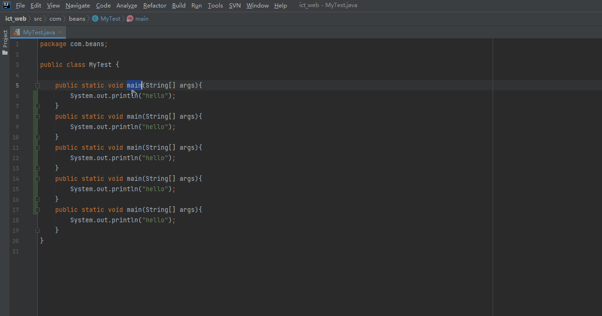

# Serial Number

> **Marketplace:** [plugins.jetbrains.com/plugin/17441-serial-number](https://plugins.jetbrains.com/plugin/17441-serial-number)
> **Source:** [github.com/Joker-Q4/serial_number](https://github.com/Joker-Q4/serial_number)

<p align="center">
  
</p>

## Introduce
* Serial Number is a plugin that helps you quickly generate serial numbers at the caret(s)
* Place multiple carets (or selections) in the editor and generate ordered numbers in one action
* Works in IntelliJ IDEA, DataGrip and other IntelliJ-based IDEs

## 介绍
* Serial Number 是一个快捷生成序号的插件
* 在多个光标(或选区)处一次性生成有序数字
* 支持 IntelliJ IDEA、DataGrip 等 IntelliJ 系 IDE

## Usage
1. Place multiple carets in the editor:
   * `Alt + Click` — add a caret
   * `Ctrl + G` — add a caret on the next line (press repeatedly for more lines)
   * Selected text is replaced by the generated number
2. Invoke the plugin:
   * Keyboard: `Ctrl + Shift + N`
   * Menu: `Code` → `Serial Number` (IntelliJ IDEA, etc.)
   * Menu: `Edit` → `Serial Number`, or right-click in the editor (DataGrip, which has no Code menu)
3. Enter `start` (first number) and `interval` (step), then click **OK**

Example: 3 carets, start = 1, interval = 2 → inserts `1`, `3`, `5` from top to bottom.

## 使用说明
1. 在编辑器中放置多个光标:
   * `Alt + 点击` — 添加光标
   * `Ctrl + G` — 在下一行添加光标(可连续按)
   * 已选中的文本会被生成的数字替换
2. 触发插件:
   * 快捷键:`Ctrl + Shift + N`
   * 菜单:IDEA 等在 `Code` 菜单;DataGrip 在 `Edit` 菜单或编辑器右键菜单(DataGrip 没有 Code 菜单)
3. 输入 `start`(起始值)和 `interval`(步长),点击 **OK**

示例:3 个光标,start = 1、interval = 2 → 按从上到下依次插入 `1`、`3`、`5`

## Install / 安装
* **JetBrains Plugin Marketplace** / 插件市场: <https://plugins.jetbrains.com/plugin/17441-serial-number>
* From a local build / 本地构建产物: **Settings → Plugins → ⚙ → Install Plugin from Disk...**

## Build
```
gradle buildPlugin                    # IntelliJ IDEA Community target (default)
gradle buildPlugin -PplatformCode=DB  # DataGrip target
```
Artifact: `build/distributions/serial_number-<version>.zip`

## Change Notes
### v1.0.12
* Added DataGrip compatibility (Edit menu and editor context menu)
* Guard against long overflow with a clear error message
* Reject out-of-range numbers in the input dialog

### v1.0.11
* Optimize version compatibility

### v1.0.10
* Upgrade gradle plugin

### v1.0.9
* Optimize version compatibility

### v1.0.8
* Optimize version compatibility

### v1.0.7
* Optimize version compatibility

### v1.0.6
* Optimize version compatibility

### v1.0.5
* Optimize version compatibility

### v1.0.4
* Optimize version compatibility

### v1.0.3
* Optimize version compatibility

### v1.0.2
* Optimize version compatibility

### v1.0.1
* Optimize version compatibility

### v1.0.0-beta03
* Optimize version compatibility

### v1.0.0-beta02
* Optimize check code

### v1.0.0-beta01
* Initial version
* Generates ordered numbers from the cursor
